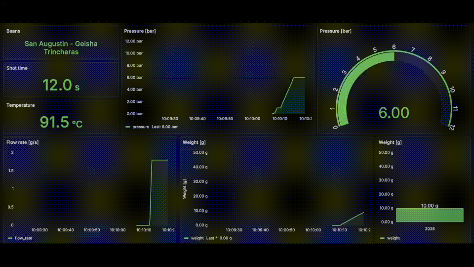

# Real Time Espresso Monitor and Logger
Logs espresso extraction data and provides visualisations to help you analyze the brew profile
* uses an Influx DB and a Grafana dashboard from a docker image
* ready to use a Bookoo bluetooth scale and pressure monitor
* includes test fakes to run simulations when the hardware sensors are not available


### Info
* shot time is started once the pressure inside the brew group exceeds a specified threshold
* shot time is ended once the flow rate drops back to 0
## Setup
### Docker images for Influx DB and Grafana
* Adapt the credentials in influxdb3-admin-token.js
* run `./start_monitor.sh` to build the containers from the attached compose file
### URLs
* Influx DB connection: http://localhost:8181
* Grafana: http://localhost:3000

(as defined in the docker compose file)

### DB registration
The InfluxDB datasource is provisioned automatically from `grafana_setup/datasource.yaml`.
Set `GRAFANA_DATA_SRC_NAME`, `INFLUXDB_HOST`, `INFLUXDB_PORT`, `INFLUXDB_DB`, and
`INFLUXDB3_ADMIN_TOKEN` in `.env`. For the settings shown here, use `influxdb3`,
`8181`, and `extractions` for the host, port, and database.

### Grafana Setup
Use `grafana-dashboard.json` for the dashboard definition

### Cleanup: delete table from the influx db:
````
TOKEN="$(python3 -c 'import json; print(json.load(open("influxdb3-admin-token.json"))["token"])')"
docker compose exec -T influxdb3 influxdb3 delete table \
  --database extractions \
  --token "$TOKEN" \
  --hard-delete now \
  extractions
unset TOKEN
````
### Load dashboard on other devices in the same LAN
Use ```` ipconfig getifaddr en0 ```` to retrieve the host IP and the port reserved for Grafana

### Check if the database is alive
`````
TOKEN="$(python3 -c 'import json; print(json.load(open("influxdb3-admin-token.json"))["token"])')"
curl -H "Authorization: Bearer $TOKEN" http://localhost:8181/health
unset TOKEN
````