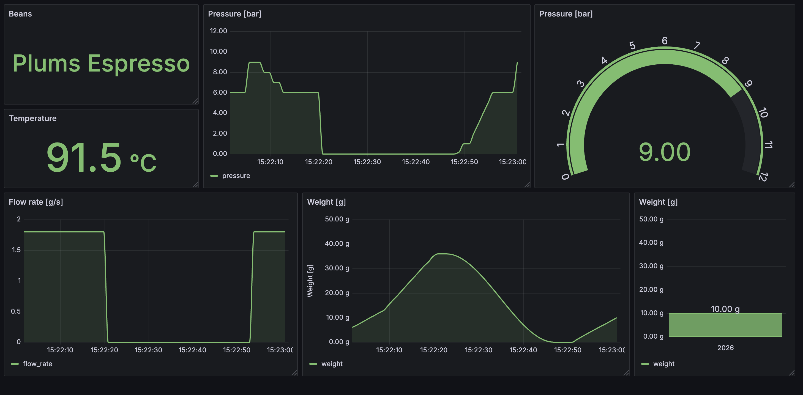

## URLs
* Influx DB connection: http://localhost:8181
* Grafana: http://localhost:3000

## Tricks
Delete all data from the influx db:

````
TOKEN="$(python3 -c 'import json; print(json.load(open("influxdb3-admin-token.json"))["token"])')"
docker compose exec -T influxdb3 influxdb3 delete table \
  --database extractions \
  --token "$TOKEN" \
  --hard-delete now \
  extractions
unset TOKEN
````